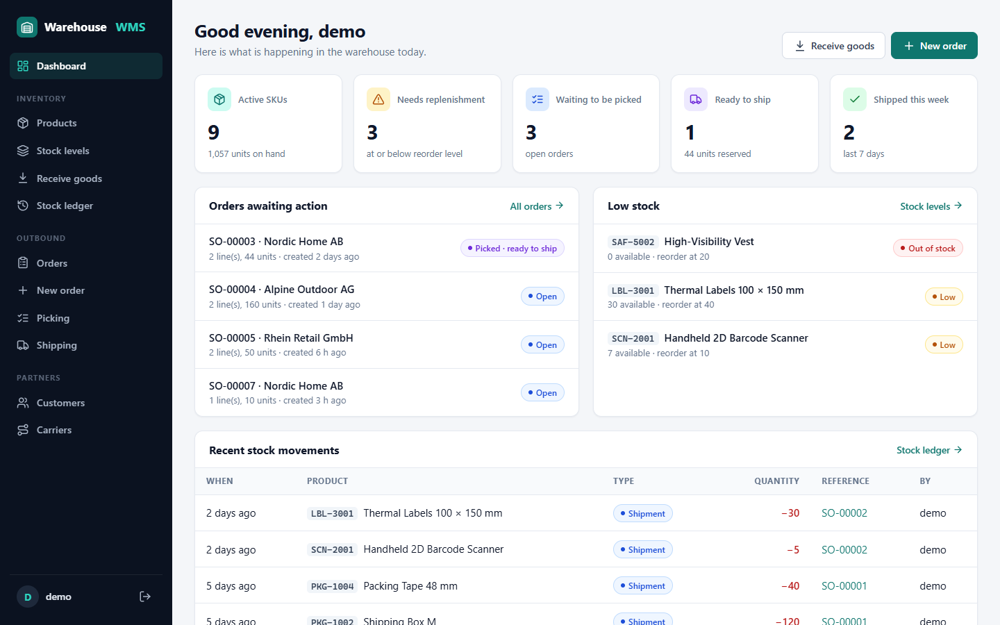
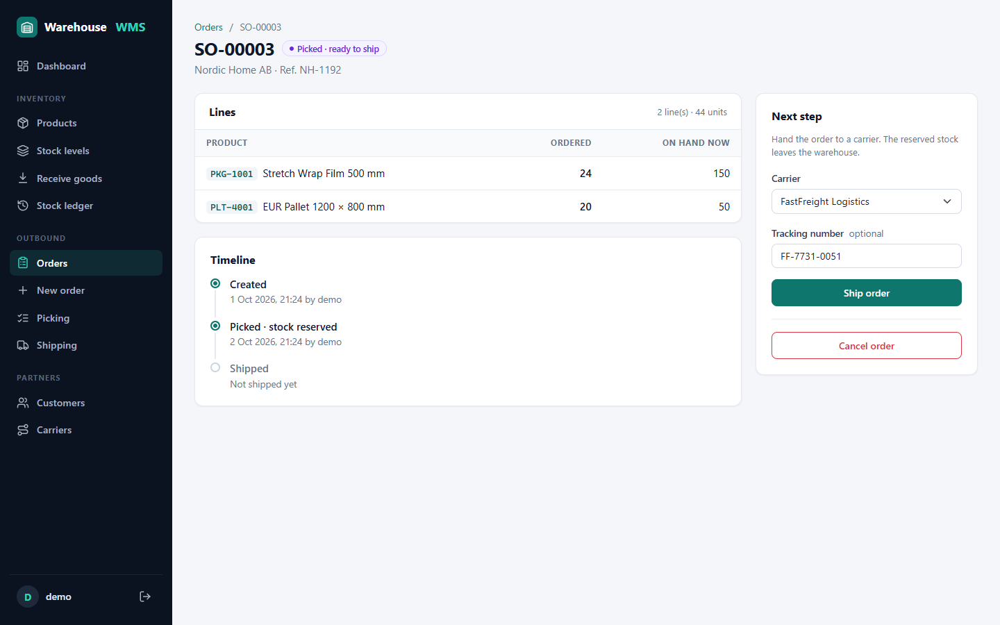
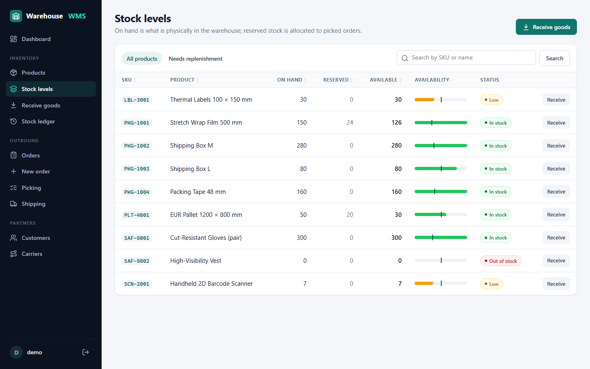
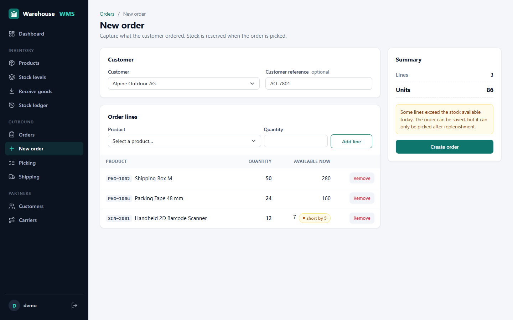
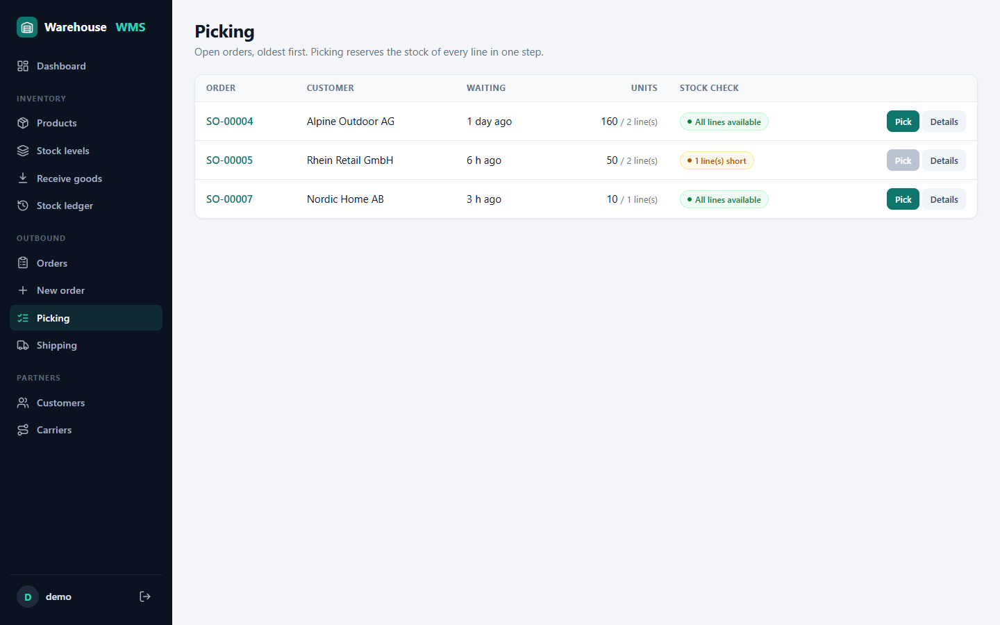
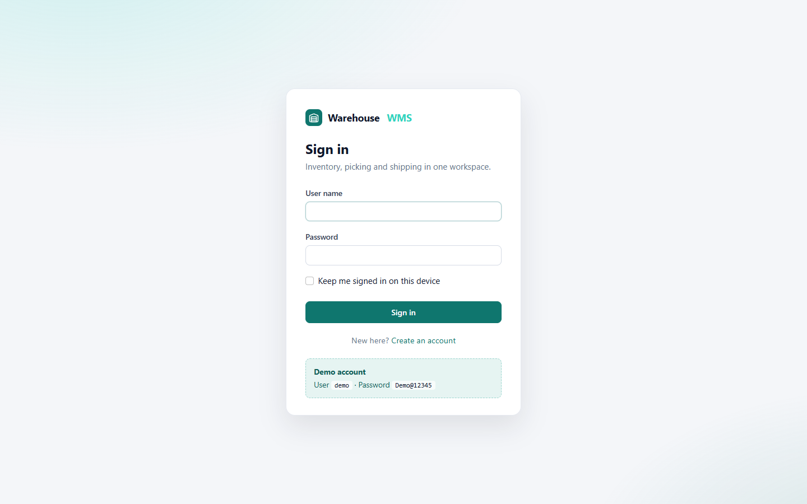
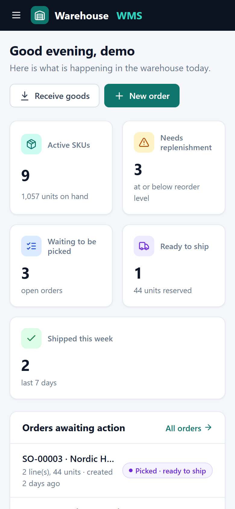
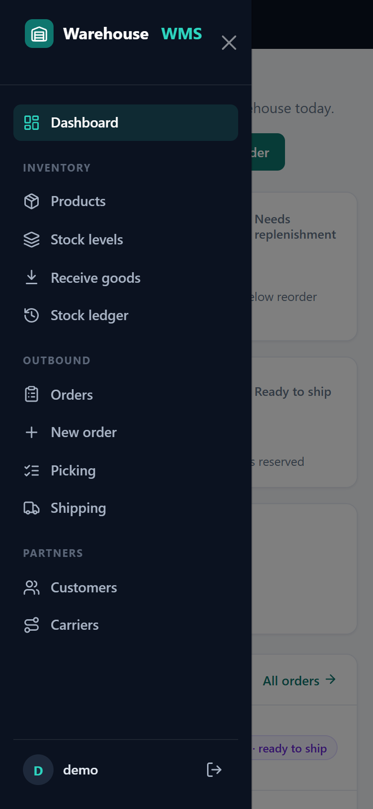
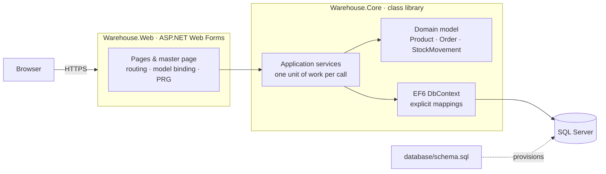
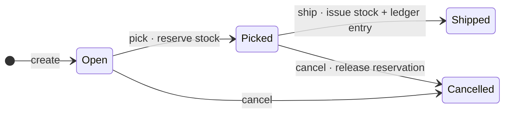

# Warehouse Management System

[](https://github.com/AtakanUk/warehouse-management-system/actions/workflows/ci.yml)


[](LICENSE)

A warehouse management system that covers the whole outbound flow: **receiving goods, keeping
stock, picking orders and shipping them**. It is built with ASP.NET Web Forms, Entity Framework 6
and SQL Server, and focuses on keeping inventory correct (also when several people work at the
same time), a rich domain model and secure defaults.



## Highlights

- **Inventory that stays correct.** Stock is tracked as *on hand*, *reserved* and *available*.
  Every receipt and shipment is written to a stock ledger, so each stock level can be traced back
  to its movements. Database check constraints back up the domain rules.
- **Explicit order lifecycle.** `Open → Picked → Shipped` (or `Cancelled`) is enforced by the
  `Order` aggregate. Picking either reserves every line or nothing. An order cannot be shipped twice.
- **Safe with concurrent users.** `ROWVERSION` columns give optimistic concurrency on products and
  orders. Two users cannot reserve the same stock or ship the same order. Integration tests
  cover both cases.
- **Secure by default.**
  - Passwords are hashed with PBKDF2-HMAC-SHA512 (210,000 iterations, per OWASP).
  - Accounts lock after repeated failed sign-ins.
  - Forms post with an anti-forgery token, and URL authorization protects every page.
  - Responses carry a Content-Security-Policy and other security headers; cookies are HttpOnly and SameSite.
  - No secrets in configuration.
- **One key press to run.** On first start the app creates the database from
  [`database/schema.sql`](database/schema.sql) and loads demo data.
- **Tested.** 57 xUnit tests: domain unit tests plus integration tests against SQL Server LocalDB.
  The CI build also compiles every `.aspx` page, so markup errors fail the build instead of
  showing up on first page load.

## Screenshots

| Order details | Stock levels |
| --- | --- |
|  |  |
| **New order** | **Picking queue** |
|  |  |
| **Sign in** | **Mobile** |
|  |   |

## Features

| Area | What you can do |
| --- | --- |
| **Dashboard** | Key figures, orders waiting for action, products below their reorder level, latest stock movements |
| **Products** | Search, sort and page the catalog. Create and edit SKUs; the edit form rejects changes if someone else saved the product in the meantime. Products with history cannot be deleted |
| **Stock levels** | On hand, reserved and available per SKU with an availability bar against the reorder level; filter to products that need replenishment |
| **Receive goods** | Book deliveries with a delivery note or PO reference; every receipt goes to the ledger |
| **Stock ledger** | Full history of receipts and shipments, filterable by type and searchable |
| **Orders** | Create multi-line orders (the same product entered twice becomes one line, and lines that exceed available stock are flagged). Filter by status, view the timeline, pick, ship or cancel |
| **Picking** | Queue of open orders, oldest first, with a live stock check; orders that are short of stock cannot be picked |
| **Shipping** | Queue of picked orders; assign a carrier and tracking number per order |
| **Customers / Carriers** | Maintain business partners; partners that are still used on orders cannot be deleted |
| **Accounts** | Sign in, registration, "keep me signed in", lockout after 5 failed attempts |

## Architecture



- **`Warehouse.Core`** has no dependency on ASP.NET.
  - Business rules live in the entities (`Order.Pick()`, `Order.Ship()`, `Product.Reserve()`, …), which have private setters.
  - Services such as `OrderService` load an aggregate, call a domain method and commit.
  - `BusinessRuleException` carries messages that are safe to show to users.
- **`Warehouse.Web`** pages are thin.
  - A shared base page provides one `DbContext` per request, Post/Redirect/Get with flash messages, and error handling.
  - Lists use Web Forms model binding with `IQueryable`, so paging and sorting run in SQL.
- **Schema first.** The SQL scripts own the schema. EF6 only maps to it (code-based configuration,
  no migrations, no `<entityFramework>` config section). The app and the integration tests
  provision databases from the same embedded scripts.

### Order lifecycle and stock



| Operation | On hand | Reserved | Available | Ledger |
| --- | --- | --- | --- | --- |
| Receive 50 | +50 | | +50 | Receipt +50 |
| Pick an order of 20 | | +20 | −20 | |
| Ship that order | −20 | −20 | | Shipment −20 |
| Cancel a picked order of 20 | | −20 | +20 | |

## Getting started

### Prerequisites

- Windows with **Visual Studio 2022** and the *ASP.NET and web development* workload. The workload
  includes IIS Express and SQL Server Express LocalDB.
- .NET Framework 4.8 Developer Pack (installed with the workload above on current Visual Studio versions).

### Run

1. Clone the repository and open `Warehouse.sln`:

   ```powershell
   git clone https://github.com/AtakanUk/warehouse-management-system.git
   ```

2. Set **Warehouse.Web** as the startup project and press **F5**.
3. On first start the app creates the `WarehouseDB` database on `(localdb)\MSSQLLocalDB` and loads demo data.
4. Sign in with **`demo` / `Demo@12345`**, or create your own account.

### Build and test from the command line

```powershell
msbuild Warehouse.sln -restore -p:Configuration=Release -p:PrecompileWebForms=true
dotnet test tests\Warehouse.Core.Tests -c Release --no-build
```

### Configuration

| Setting (`src/Warehouse.Web/Web.config`) | Default | Purpose |
| --- | --- | --- |
| `connectionStrings/WarehouseDb` | LocalDB, Windows authentication | Any SQL Server 2016+ instance |
| `Warehouse:ProvisionDatabase` | `true` | Create the database from `schema.sql` when it does not exist |
| `Warehouse:SeedDemoData` | `true` | Load `seed.sql` into a newly created database |
| `Warehouse:ShowDemoCredentials` | `true` | Show the demo account on the sign-in page |

`Web.Release.config` turns all three off and also:

- sets `customErrors` to `On`,
- makes the authentication and session cookies HTTPS-only,
- adds HSTS.

**Reset the demo data:** drop the database, then restart the site. The next start provisions it again.

```powershell
sqlcmd -S "(localdb)\MSSQLLocalDB" -E -Q "ALTER DATABASE WarehouseDB SET SINGLE_USER WITH ROLLBACK IMMEDIATE; DROP DATABASE WarehouseDB"
```

**Create the database manually** (for example on a shared server):

```powershell
sqlcmd -S <server> -E -Q "CREATE DATABASE WarehouseDB"
sqlcmd -S <server> -E -d WarehouseDB -i database\schema.sql
sqlcmd -S <server> -E -d WarehouseDB -i database\seed.sql   # optional demo data
```

## Testing

```text
tests/Warehouse.Core.Tests
├── Domain/           Product, Order and User rules (pure unit tests)
├── Security/         Password hashing, incl. a check that the seeded demo hash matches the docs
└── Integration/      Services against a real SQL Server database
```

The integration tests create a temporary database from the real scripts, run the full
receive → pick → ship workflow and drop the database afterwards. The scenarios include:

- the inventory ledger invariants,
- shipping the same order twice,
- two users shipping or picking at the same moment (optimistic concurrency),
- editing a product with a stale version,
- duplicate SKUs,
- account lockout.

The tests use LocalDB by default. Set `WMS_TEST_SQLSERVER` to use another server. When no server
is reachable, the integration tests are skipped instead of failing.

## Security notes

- **Passwords:** PBKDF2-HMAC-SHA512 with a 16-byte random salt and 210,000 iterations.
  - Comparison runs in constant time.
  - The hash format records its work factor, and older hashes are upgraded on the next sign-in.
  - Unknown user names cost the same time as wrong passwords, so timing does not reveal which accounts exist.
- **Brute force:** an account locks for 5 minutes after 5 failed sign-ins.
- **CSRF:** a random token is kept in an HttpOnly cookie and bound to the MAC-protected view state
  together with the user name.
- **Access control:** the URL authorization rule `<deny users="?" />` covers every page. Only
  sign-in, registration, error pages and static assets are public. Return URLs are validated, so
  there are no open redirects.
- **Headers:** `Content-Security-Policy`, `X-Frame-Options: DENY`, `X-Content-Type-Options`,
  `Referrer-Policy` and `Permissions-Policy` are set. `Server`, `X-Powered-By` and
  `X-AspNet-Version` are removed.
  - The CSP allows `'unsafe-inline'`/`'unsafe-eval'` for scripts only because the Web Forms
    runtime needs them (`__doPostBack`, client-side validators).
- **Data access:** all queries go through EF6 and are parameterized. All output is HTML-encoded.
  The database has CHECK, UNIQUE and FOREIGN KEY constraints as a second line of defence.

## Design decisions

- **Reserve at picking, not at order entry.** Orders can be taken even when stock is short, which
  is how sales usually works. The picking queue shows which orders can actually be fulfilled now.
- **Optimistic concurrency instead of locks.** Conflicts are rare in a warehouse, and failing one
  of two simultaneous requests with a clear message is safer than holding database locks across
  a web request.
- **The SQL scripts are the single source of truth for the schema.** They are reviewed like code,
  embedded in `Warehouse.Core` and used by the app, the tests and manual setups alike.
- **No DI container.** The application is small. A per-request `DbContext` in the base page and
  constructor-injected services keep the wiring visible, and `Warehouse.Core` stays fully testable.

## Project structure

```text
├── database/                 schema.sql (tables, constraints, indexes) and seed.sql (demo data)
├── docs/screenshots/
├── src/
│   ├── Warehouse.Core/       domain model, services, EF6 mapping, password hashing
│   └── Warehouse.Web/        Web Forms pages, master page, routing, styles
├── tests/
│   └── Warehouse.Core.Tests/ xUnit unit and integration tests
└── .github/workflows/ci.yml  build, compile markup, run tests
```

## Ideas for further work

Bin locations and put-away, cycle counts and stock adjustments, purchase orders, role-based
permissions (receiving vs. shipping), barcode scanning on handheld devices, and a REST API for
carrier integrations.

## License

[MIT](LICENSE) © 2026 Atakan Ük. Third-party components are listed in
[THIRD-PARTY-NOTICES.md](THIRD-PARTY-NOTICES.md).
